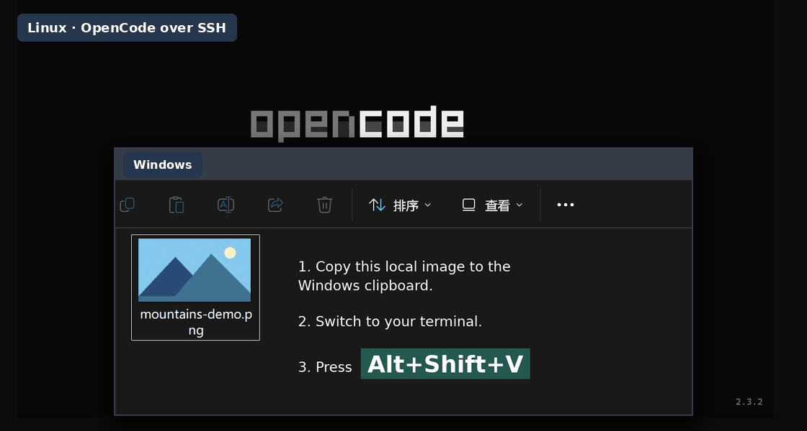
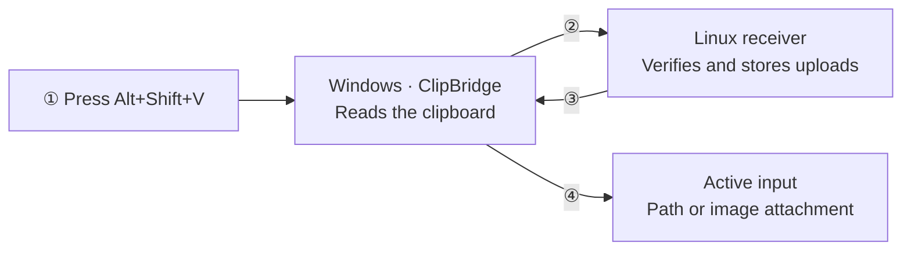

# clip-win-linux

<p align="center"><strong>English</strong> | <a href="README.zh.md">简体中文</a></p>

clip-win-linux builds a bridge called **ClipBridge** between the Windows clipboard and a Linux terminal. It sends images, files, and folders over SSH, then pastes the returned absolute Linux paths into the current terminal.



## Features

- **Paste files of any type.** Copy files or folders on Windows and paste their absolute Linux paths into your remote terminal.
- **Reuse a dedicated SSH connection.** ClipBridge keeps the transfer connection open and can start and stop alongside your terminal application.
- **Use the same Windows clipboard across terminals and agents.** Copy in one Windows app and paste into the terminal and agent you use.
- **See images as attachments.** Agents that recognize pasted image paths automatically show an image tag such as `[image #1]` in the input box.

## Usage

Copy an image, file, or folder on Windows. Switch to your terminal and press `Alt+Shift+V`.

## Deploy via agent

Copy the prompt below into your agent. The deployment instructions are in [AGENTS.md](AGENTS.md) and [DEPENDENCIES.md](DEPENDENCIES.md).

```text
Deploy clip-win-linux for me using https://github.com/NewbieToEverything/clip-win-linux. Read AGENTS.md and DEPENDENCIES.md first. Choose a Windows installation directory and SSH alias that fit my setup. Enable automatic paste for the terminal I use, verify a transfer end to end, and tell me which steps need my input.
```

## Deploy manually

Check [Deployment dependencies](DEPENDENCIES.md) first. The default SSH alias is `linux`. You can specify a different alias. Choose a Windows installation directory, such as `%LOCALAPPDATA%\ClipBridge`, and keep the EXE and its scripts together there.

1. On Linux, install Python 3.9 or later, then run `bash linux/install.sh` from the repository. This installs the receiver and enables hourly cache cleanup.
2. Configure the Linux SSH server to accept `CLIPBRIDGE_WS`. See the [deployment guide](AGENTS.md#linux-端) for how to check and reload sshd. Keep your existing SSH session open until the new connection works.
3. In the Windows OpenSSH configuration, add `SetEnv CLIPBRIDGE_WS=workspace-a` to the `Host linux` entry. Use `workspace-b` on a second device. Verify the connection:

   ```powershell
   ssh -nT -o BatchMode=yes -o StrictHostKeyChecking=yes linux '~/.local/bin/clipbridge doctor'
   ```

4. Run `windows/build-hotkey.ps1` in a supported Windows build environment. Place the resulting `ClipBridgeHotkey.exe` alongside `clipbridge-agent.ps1` and `clipbridge-notify.ps1`.
5. From the installation directory, start ClipBridge with automatic paste enabled for Windows Terminal. Replace `WindowsTerminal.exe` with your terminal’s executable name if needed.

   ```powershell
   .\ClipBridgeHotkey.exe --ssh-host linux --auto-paste WindowsTerminal.exe
   ```

### Start and stop ClipBridge with your own terminal application

The launcher starts ClipBridge alongside your terminal application and waits for active transfers before closing it. The steps below use XPipe as the example.

1. Run `install-user-startup.ps1 -SshHost linux -AutoPasteTerminal WindowsTerminal.exe` to configure the `ClipBridge Hotkey` scheduled task. The launcher reads its startup arguments from this task.
2. Place `start-with-xpipe.ps1` and `start-with-xpipe.vbs` alongside the EXE. Copy your original XPipe shortcut into that directory as `XPipe-original.lnk`.
3. Create a Windows shortcut with the target `wscript.exe //B //Nologo "<Windows install directory>\start-with-xpipe.vbs"`. Adjust the path for your installation and pin the shortcut to the taskbar.
4. Run `Stop-ScheduledTask -TaskName 'ClipBridge Hotkey'` and `Disable-ScheduledTask -TaskName 'ClipBridge Hotkey'` in Windows PowerShell. Keep the task so the launcher can read its arguments. Use the new shortcut to open XPipe.

You can use the same lifecycle mechanism with a different terminal application. In the [launcher script](windows/start-with-xpipe.ps1), change the startup shortcut and the main process name it tracks (currently `xpiped`). The launcher uses that process exiting as the signal to shut down ClipBridge.

## Architecture

### ClipBridge components


The Windows upload agent starts the Linux receiver (`clipbridge serve --stdio`) through OpenSSH. The open terminal uses its own SSH session.

Open XPipe from the integration shortcut and ClipBridge connects in the background. When XPipe exits completely, ClipBridge finishes any active upload before disconnecting. Closing an SSH tab, or closing the window while XPipe stays in the background, leaves the connection open.

### How does a file or folder reach the input box after Alt+Shift+V?



- **① → ②** **Read and upload.** When you press `Alt+Shift+V`, ClipBridge sends the copied files, folders, or images to Linux over its dedicated persistent SSH connection.
- **③** **Save and return the path.** The Linux receiver verifies and stores the items, then returns their absolute paths to Windows.
- **④** **Paste into the current input.** After a successful receipt, ClipBridge writes the path to the Windows clipboard if it has not changed. If automatic paste is enabled and the terminal checks pass, ClipBridge triggers `Ctrl+Shift+V`. An agent that recognizes image paths, such as Codex CLI, displays the image as an attachment. The path stays out of `Win+V` history.

Regular files and folders appear as absolute Linux paths.

If automatic paste is skipped and the path is on the clipboard, use your terminal’s paste shortcut. If the clipboard could not be updated, run `clipbridge latest` in the same workspace.

Files are stored under `~/.local/share/clipbridge/<workspace>/batches/`. Hourly cleanup applies the 24-hour lifetime, disk quotas, and recent-upload protection. Keep a separate copy of any files you need long term.

Run receiver tests with `/usr/bin/python3 -B -m unittest discover -s tests -v`. See the [desktop checklist](tests/manual-test-matrix.md) for Windows PowerShell and terminal verification.

## Configuration

| Setting | Default | Purpose |
|---|---|---|
| `--ssh-host alias` | `linux` | Dedicated Windows upload connection. Uses the alias's existing credentials and host key settings. |
| SSH `SetEnv CLIPBRIDGE_WS` | Required | Use `workspace-a` or `workspace-b` to keep uploads from different devices in separate directories. |
| `--auto-paste terminal.exe` | Off when omitted. Enabled by the deployment command above. | Automatically paste into the specified foreground terminal, such as `WindowsTerminal.exe`. |
| `--paste-timeout seconds` | 8 seconds | Maximum wait for automatic paste, from 1 to 60 seconds. |
| PNG limit | 15 MiB | Maximum size after encoding a clipboard bitmap as PNG. |
| File limit | 128 MiB | Maximum size per regular file. |
| Batch limit | 256 MiB | Maximum batch size, with up to 200 file and directory entries. |
| Cache lifetime | 24 hours | Default retention. Quotas and recent-upload protection also govern cleanup. |
