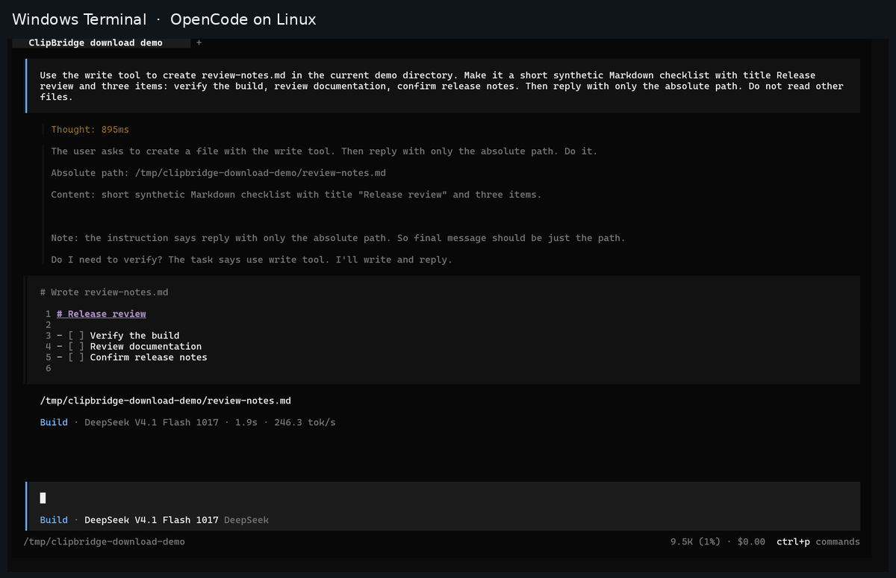
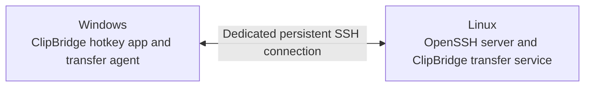
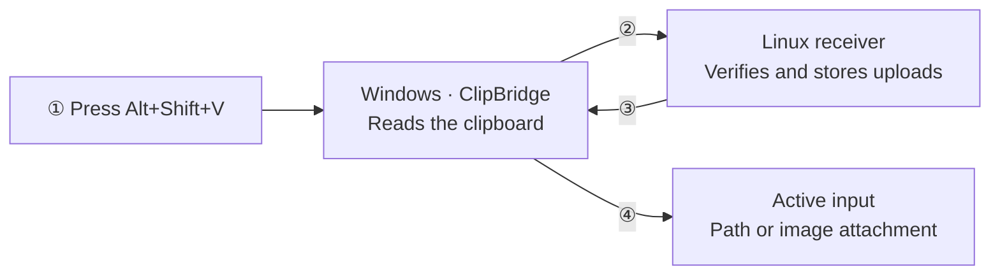
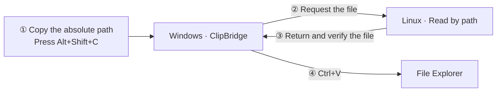

# clip-win-linux

<p align="center"><strong>English</strong> | <a href="README.zh.md">简体中文</a></p>

clip-win-linux is a two-way file transfer bridge called **ClipBridge** between the Windows clipboard and a Linux terminal. Press `Alt+Shift+V` on Windows to send images, files, or folders to Linux and paste the returned absolute paths into your terminal. Copy a Linux absolute path and press `Alt+Shift+C` to bring the file or folder back, then paste it in Windows File Explorer. Both directions use the same dedicated SSH connection.

## Demo

### Copy a Windows file to Linux


### Copy a Linux file to Windows



## Features

### Windows → Linux

- **Send with `Alt+Shift+V`.** Send images, files, and folders from the Windows clipboard and paste their absolute Linux paths into your remote terminal.
- **Paste images as attachments.** Agents that recognize pasted image paths show an image tag such as `[image #1]`.

### Linux → Windows

- **Download with `Alt+Shift+C`.** Copy the absolute path of a Linux file or folder from any SSH terminal. ClipBridge can rejoin a wrapped path when it resolves to exactly one existing path.
- **Paste files in File Explorer.** After ClipBridge downloads and verifies the item, press `Ctrl+V` to paste the file or the entire folder. ClipBridge periodically cleans up its Windows download cache.

Both directions use the Windows clipboard and the same dedicated SSH connection across terminals and agents. ClipBridge can start and stop alongside your terminal application.

## Usage

- **Send to Linux.** Copy an image, file, or folder on Windows. Switch to your terminal and press `Alt+Shift+V`.
- **Bring files back to Windows.** Copy one absolute Linux file or folder path from the terminal and press `Alt+Shift+C`. Once the download finishes, press `Ctrl+V` in File Explorer.

## Deploy via agent

Copy the prompt below into your agent. The deployment instructions are in [AGENTS.md](AGENTS.md) and [DEPENDENCIES.md](DEPENDENCIES.md).

```text
Deploy clip-win-linux for me using https://github.com/NewbieToEverything/clip-win-linux. Read AGENTS.md and DEPENDENCIES.md first. Choose a Windows installation directory and SSH alias that fit my setup. Enable automatic paste for the terminal I use, verify an end-to-end transfer in each direction, and tell me which steps need my input.
```

## Deploy manually

Check [Deployment dependencies](DEPENDENCIES.md) first. The default SSH alias is `linux`. You can specify a different alias. Choose a Windows installation directory, such as `%LOCALAPPDATA%\ClipBridge`, and keep the EXE and its scripts together there.

1. On Linux, install Python 3.9 or later, then run `bash linux/install.sh` from the repository. This installs the receiver and enables hourly cache cleanup.
2. Configure the Linux SSH server to accept `CLIPBRIDGE_WS`. See the [deployment guide](AGENTS.md#linux-端) for how to check and reload sshd. Keep your existing SSH session open until the new connection works.
3. In the Windows OpenSSH configuration, add `SetEnv CLIPBRIDGE_WS=workspace-a` to the `Host linux` entry. Use `workspace-b` on a second device. Verify the connection:

   ```powershell
   ssh -nT -o BatchMode=yes -o StrictHostKeyChecking=yes linux '~/.local/bin/clipbridge doctor'
   ```

4. Run `windows/build-hotkey.ps1` in a supported Windows build environment. Place the resulting `ClipBridgeHotkey.exe` alongside `clipbridge-agent.ps1` and `clipbridge-notify.ps1`.
5. From the installation directory, start ClipBridge with automatic paste enabled for Windows Terminal. Replace `WindowsTerminal.exe` with your terminal’s executable name if needed.

   ```powershell
   .\ClipBridgeHotkey.exe --ssh-host linux --auto-paste WindowsTerminal.exe
   ```

6. Send a test file to Linux with `Alt+Shift+V`. Copy the returned absolute path, press `Alt+Shift+C`, then paste and check the file in Windows File Explorer.

### Start and stop ClipBridge with your own terminal application

The launcher starts ClipBridge alongside your terminal application and waits for active transfers before closing it. The steps below use XPipe as the example.

1. Run `install-user-startup.ps1 -SshHost linux -AutoPasteTerminal WindowsTerminal.exe` to configure the `ClipBridge Hotkey` scheduled task. The launcher reads its startup arguments from this task.
2. Place `start-with-xpipe.ps1` and `start-with-xpipe.vbs` alongside the EXE. Copy your original XPipe shortcut into that directory as `XPipe-original.lnk`.
3. Create a Windows shortcut with the target `wscript.exe //B //Nologo "<Windows install directory>\start-with-xpipe.vbs"`. Adjust the path for your installation and pin the shortcut to the taskbar.
4. Run `Stop-ScheduledTask -TaskName 'ClipBridge Hotkey'` and `Disable-ScheduledTask -TaskName 'ClipBridge Hotkey'` in Windows PowerShell. Keep the task so the launcher can read its arguments. Use the new shortcut to open XPipe.

You can use the same lifecycle mechanism with a different terminal application. In the [launcher script](windows/start-with-xpipe.ps1), change the startup shortcut and the main process name it tracks (currently `xpiped`). The launcher uses that process exiting as the signal to shut down ClipBridge.

## Architecture

### ClipBridge components



The Windows transfer agent starts the Linux service (`clipbridge serve --stdio`) through OpenSSH. Windows initiates both uploads and downloads over this dedicated connection. Your terminal uses its own SSH session.

Open XPipe from the integration shortcut and ClipBridge connects in the background. When XPipe exits completely, ClipBridge finishes any active transfer before disconnecting. Closing an SSH tab, or closing the window while XPipe stays in the background, leaves the connection open.

### How does a file or folder reach the input box after Alt+Shift+V?



- **① → ②** **Read and upload.** When you press `Alt+Shift+V`, ClipBridge sends the copied files, folders, or images to Linux over its dedicated persistent SSH connection.
- **③** **Save and return the path.** The Linux receiver verifies and stores the items, then returns their absolute paths to Windows.
- **④** **Paste into the current input.** After a successful receipt, ClipBridge writes the path to the Windows clipboard if it has not changed. If automatic paste is enabled and the terminal checks pass, ClipBridge triggers `Ctrl+Shift+V`. An agent that recognizes image paths, such as Codex CLI, displays the image as an attachment. The path stays out of `Win+V` history.

Regular files and folders appear as absolute Linux paths.

If automatic paste is skipped and the path is on the clipboard, use your terminal’s paste shortcut. If the clipboard could not be updated, run `clipbridge latest` in the same workspace.

Files are stored under `~/.local/share/clipbridge/<workspace>/batches/`. Hourly cleanup applies the 24-hour lifetime, disk quotas, and recent-upload protection. Keep a separate copy of any files you need long term.

Run receiver tests with `/usr/bin/python3 -B -m unittest discover -s tests -v`. See the [desktop checklist](tests/manual-test-matrix.md) for Windows PowerShell and terminal verification.

### How does a file reach Windows after Alt+Shift+C?



ClipBridge reads one absolute Linux path from the Windows clipboard and requests it over the same dedicated SSH connection. It trims surrounding whitespace. If the terminal wrapped the path, ClipBridge tries to rejoin it and downloads only when exactly one reconstructed path exists.

Downloads support regular files and folders, up to 200 entries, 128 MiB per file and 256 MiB per transfer. ClipBridge rejects symbolic links and names that cannot be used on Windows.

Files are downloaded to `%LOCALAPPDATA%\ClipBridge\Downloads`. ClipBridge puts the file on the Windows clipboard after checksum verification. If the clipboard changes during the download, the files stay in the cache. ClipBridge removes downloads older than 24 hours at startup and once an hour while running.

## Configuration

| Setting | Default | Purpose |
|---|---|---|
| `--ssh-host alias` | `linux` | Dedicated Windows transfer connection. Uses the alias's existing credentials and host key settings. |
| SSH `SetEnv CLIPBRIDGE_WS` | Required | Use `workspace-a` or `workspace-b` to keep uploads from different devices in separate directories. |
| `--auto-paste terminal.exe` | Off when omitted. Enabled by the deployment command above. | Automatically paste into the specified foreground terminal, such as `WindowsTerminal.exe`. |
| `--paste-timeout seconds` | 8 seconds | Maximum wait for automatic paste, from 1 to 60 seconds. |
| PNG limit | 15 MiB | Maximum size after encoding a clipboard bitmap as PNG. |
| File limit | 128 MiB | Maximum size per regular file. |
| Transfer limit | 256 MiB | Maximum batch size in either direction, with up to 200 file and directory entries. |
| Linux upload cache lifetime | 24 hours | Default retention. Quotas and recent-upload protection also govern cleanup. |
| Windows download cache lifetime | 24 hours | ClipBridge checks at startup and hourly while running. |
