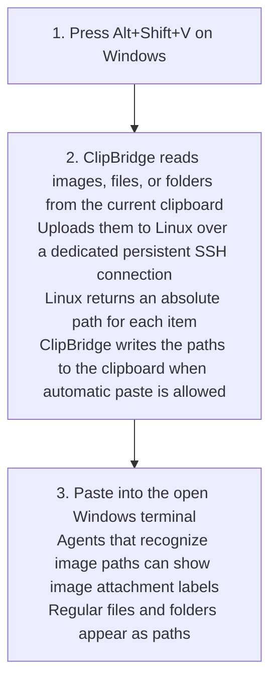
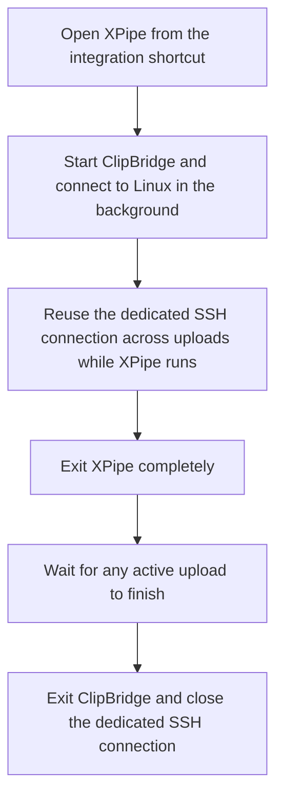

# clip-win-linux

<p align="center"><strong>English</strong> | <a href="README.zh.md">简体中文</a></p>

ClipBridge sends images, files, and folders from the Windows clipboard to Linux over SSH. It returns an absolute Linux path for each uploaded item and can automatically paste those paths into your SSH terminal on Windows.

> **Deploying with an agent?** Ask it to read [AGENTS.md](AGENTS.md) and [the deployment dependencies](DEPENDENCIES.md) first, then use an installation directory and SSH alias that fit your setup.

## Architecture

### One upload



With automatic paste enabled, ClipBridge writes the returned paths after checking focus, the timeout, and whether the clipboard changed. It excludes the paths from `Win+V` history. Uploads and the terminal use separate SSH connections. The Linux receiver uses SSH standard input and output and works without a graphical session. The setup has been verified on Debian. Other distributions need Python 3, Pillow, and OpenSSH. For scheduled cache cleanup, use a systemd user timer or run the cleanup command with your system's scheduler.

### SSH connection lifecycle with XPipe (optional)



The launcher follows the XPipe process. The connection stays open if you close an SSH tab or dismiss the window while XPipe is still running in the background.

## Quick start

Check [Deployment dependencies](DEPENDENCIES.md) first. The default SSH alias is `linux`. You can specify a different alias. Choose a Windows installation directory, such as `%LOCALAPPDATA%\ClipBridge`, and keep the EXE and its scripts together there.

1. On Debian, install Python 3 and Pillow, then run `bash debian/install.sh` from the repository. This installs the receiver and enables hourly cache cleanup.
2. Configure Debian's SSH server to accept `CLIPBRIDGE_WS`. See the [deployment guide](AGENTS.md#debian-端) for how to check and reload sshd. Keep your existing SSH session open until the new connection works.
3. In the Windows OpenSSH configuration, add `SetEnv CLIPBRIDGE_WS=workspace-a` to the `Host linux` entry. Use `workspace-b` on a second device. Verify the connection:

   ```powershell
   ssh -nT -o BatchMode=yes -o StrictHostKeyChecking=yes linux '~/.local/bin/clipbridge doctor'
   ```

4. Run `windows/build-hotkey.ps1` in a supported Windows build environment. Place the resulting `ClipBridgeHotkey.exe` alongside `clipbridge-agent.ps1` and `clipbridge-notify.ps1`.
5. Run `./ClipBridgeHotkey.exe --ssh-host linux` from the installation directory, copy an image, file, or folder, and press `Alt+Shift+V`. The Direct2D and DirectWrite progress card appears after about 300 ms to avoid flashing for quick uploads. The receiver preserves existing names and directory structure and returns absolute Linux paths for all items.

### Enable automatic paste (optional)

Run the following command from the directory containing the EXE. If ClipBridge is already running, first run `.\ClipBridgeHotkey.exe --stop`, then start it with the new arguments.

```powershell
.\ClipBridgeHotkey.exe --ssh-host linux --auto-paste WindowsTerminal.exe
```

### Start and stop with XPipe (optional)

When XPipe exits, the optional launcher waits for any active upload before closing ClipBridge.

1. Run `install-user-startup.ps1 -SshHost linux -AutoPasteTerminal WindowsTerminal.exe` to configure the `ClipBridge Hotkey` scheduled task. The launcher reads its startup arguments from this task.
2. Place `start-with-xpipe.ps1` and `start-with-xpipe.vbs` alongside the EXE. Copy your original XPipe shortcut into that directory as `XPipe-original.lnk`.
3. Create a Windows shortcut with the target `wscript.exe //B //Nologo "<Windows install directory>\start-with-xpipe.vbs"`. Adjust the path for your installation and pin the shortcut to the taskbar.
4. Run `Stop-ScheduledTask -TaskName 'ClipBridge Hotkey'` and `Disable-ScheduledTask -TaskName 'ClipBridge Hotkey'` in Windows PowerShell. Keep the task so the launcher can read its arguments. Use the new shortcut to open XPipe.

## Configuration

| Setting | Default | Purpose |
|---|---|---|
| `--ssh-host alias` | `linux` | Dedicated Windows upload connection. Uses the alias's existing credentials and host key settings. |
| SSH `SetEnv CLIPBRIDGE_WS` | Required | Use `workspace-a` or `workspace-b` to keep uploads from different devices in separate directories. |
| `--auto-paste terminal.exe` | Off | Automatically paste into the specified foreground terminal, such as `WindowsTerminal.exe`. |
| `--paste-timeout seconds` | 8 seconds | Maximum wait for automatic paste, from 1 to 60 seconds. |
| PNG limit | 15 MiB | Maximum size after encoding a clipboard bitmap as PNG. |
| File limit | 128 MiB | Maximum size per regular file. |
| Batch limit | 256 MiB | Maximum batch size, with up to 200 file and directory entries. |
| Cache lifetime | 24 hours | Default retention. Quotas and recent-upload protection also govern cleanup. |

## Usage

- Press `Alt+Shift+V` to upload from the Windows clipboard. ClipBridge reuses its dedicated SSH connection. Automatic paste requires a matching foreground window, an unexpired timeout, and an unchanged clipboard. If automatic paste is skipped, retrieve the paths with `clipbridge latest` in the corresponding workspace. It writes the returned paths to the current clipboard and marks them for exclusion from `Win+V` history.
- Automatic paste uses the terminal's `Ctrl+Shift+V` shortcut. Image paths have been verified to become attachments in remote Codex CLI on Debian. For OpenCode, Pi, and Hermes, the display depends on the version and input interface. See the [desktop checklist](tests/manual-test-matrix.md). Regular files and folders still return paths.
- The progress card appears in the lower-right corner of the original window's monitor without taking focus. It shows a percentage when the total byte count is known. Check display quality at 100%, 125%, 150%, and 200% scaling on Windows.
- `windows/clipbridge-send.ps1` accepts the same alias via `-SshHost`, performs a one-off PNG or archive upload and prints the returned absolute Linux paths.
- `clipbridge doctor` checks workspace routing and storage.
- `clipbridge latest` shows the latest successful receipt for the workspace.
- `clipbridge stats --all` reports cache usage.
- `clipbridge prune --all [--dry-run]` runs or previews cache cleanup.
- `clipbridge serve --stdio` is the framed protocol endpoint for the persistent SSH connection.

Files are stored under `~/.local/share/clipbridge/<workspace>/batches/`. Hourly cleanup applies the 24-hour lifetime, disk quotas, and recent-upload protection. Keep a separate copy of any files you need long term.

Run receiver tests with `/usr/bin/python3 -B -m unittest discover -s tests -v`. See the [desktop checklist](tests/manual-test-matrix.md) for Windows PowerShell and terminal verification.
