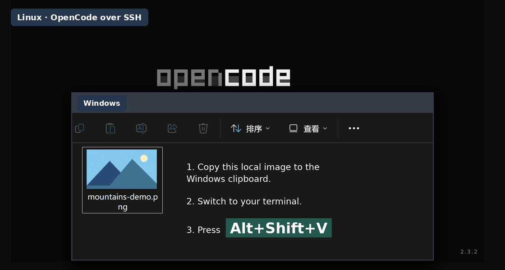
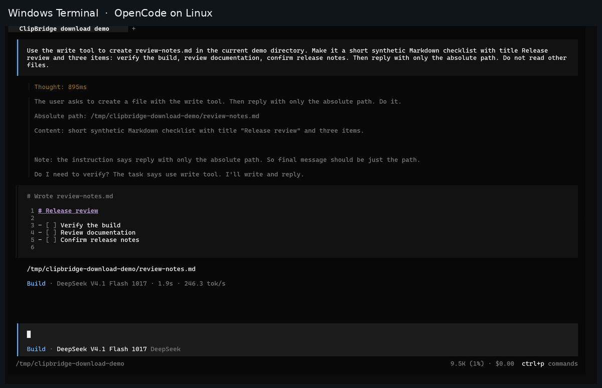
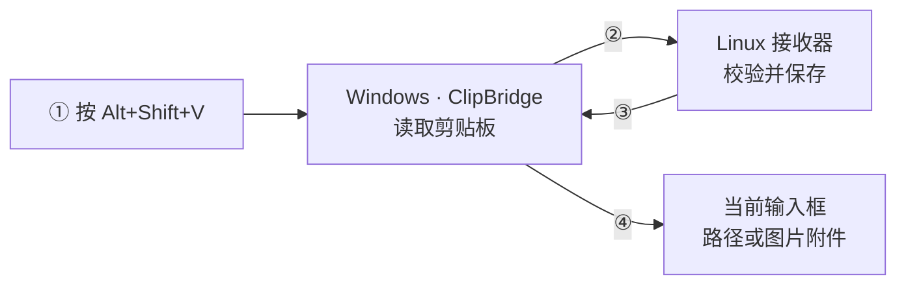
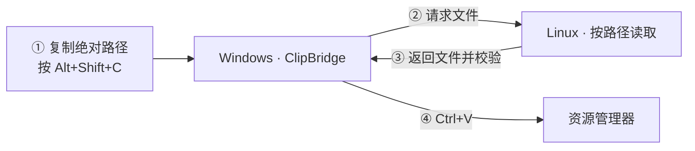

# clip-win-linux

<p align="center"><a href="README.md">English</a> | <strong>简体中文</strong></p>

clip-win-linux 是一座连接 Windows 剪贴板和 Linux 终端的双向文件传输桥，称为 **ClipBridge**。在 Windows 按 `Alt+Shift+V`，可以把图片、文件或文件夹发到 Linux，并将返回的绝对路径贴进终端。复制一个 Linux 绝对路径后按 `Alt+Shift+C`，可以把对应的文件或文件夹取回 Windows，再在资源管理器粘贴。两个方向共用一条专用 SSH 长连接。

## 演示

### 从 Windows 复制文件到 Linux



### 从 Linux 复制文件到 Windows



## 功能特性

### Windows → Linux

- **按 `Alt+Shift+V` 发送。** 从 Windows 剪贴板发送图片、文件和文件夹，再把对应的 Linux 绝对路径贴进远端终端。
- **把图片贴成附件。** 支持识别图片路径的 Agent 会显示图片标签，例如 `[image #1]`。

### Linux → Windows

- **按 `Alt+Shift+C` 下载。** 从任意 SSH 终端复制一个 Linux 文件或文件夹的绝对路径。终端里的路径断行后，只要能还原出唯一有效路径，就可以下载。
- **在资源管理器粘贴实际文件。** 下载并校验完成后，按 `Ctrl+V` 粘贴文件或整个文件夹。Windows 下载缓存会定期清理。

两个方向共用 Windows 剪贴板和一条专用 SSH 长连接，跨终端和 Agent 都能使用。ClipBridge 可随终端程序启动和退出。

## 用法

- **发到 Linux。** 在 Windows 复制图片、文件或文件夹。切换到终端，按 `Alt+Shift+V`。
- **取回到 Windows。** 在终端复制一个 Linux 文件或文件夹的绝对路径，按 `Alt+Shift+C`。下载完成后，在资源管理器按 `Ctrl+V` 粘贴。

## 用 Agent 部署

把下面这段提示词复制给 Agent。部署说明见 [AGENTS.md](AGENTS.md) 和 [DEPENDENCIES.md](DEPENDENCIES.md)。

```text
请用 https://github.com/NewbieToEverything/clip-win-linux 帮我部署 clip-win-linux。先读 AGENTS.md 和 DEPENDENCIES.md。按我的环境选择 Windows 安装目录和 SSH 别名，为我使用的终端开启自动粘贴，并验证 Windows → Linux 和 Linux → Windows 各一次完整传输。告诉我哪些步骤需要我操作。
```

## 手动部署

先按 [部署依赖](DEPENDENCIES.md) 检查环境。默认 SSH 别名是 `linux`，也可以指定其他别名。请选择 Windows 安装目录，例如当前用户的 `%LOCALAPPDATA%\ClipBridge`。Windows 脚本和 EXE 放在同一目录。

1. 在 Linux 安装 Python 3.9 或更新版本后，在仓库运行 `bash linux/install.sh`。该脚本安装接收器并启用每小时缓存清理计时器。
2. Linux 上的 sshd 必须允许 `CLIPBRIDGE_WS` 环境变量。检查并重载 sshd 的步骤见 [Agent 部署指南](AGENTS.md#linux-端)。保持现有 SSH 会话，直到新连接验证成功。
3. Windows OpenSSH 配置中的 `Host linux` 段设置 `SetEnv CLIPBRIDGE_WS=workspace-a`；设备 B 使用 `workspace-b`。验证：

   ```powershell
   ssh -nT -o BatchMode=yes -o StrictHostKeyChecking=yes linux '~/.local/bin/clipbridge doctor'
   ```

4. 在 Windows 构建环境运行 `windows/build-hotkey.ps1`。将生成的 `ClipBridgeHotkey.exe`、`clipbridge-agent.ps1` 和 `clipbridge-notify.ps1` 放在同一目录。
5. 在安装目录运行下面的命令，为 Windows Terminal 开启自动粘贴。使用其他终端时，将 `WindowsTerminal.exe` 换成对应的可执行文件名。

   ```powershell
   .\ClipBridgeHotkey.exe --ssh-host linux --auto-paste WindowsTerminal.exe
   ```

6. 用 `Alt+Shift+V` 发一个测试文件到 Linux。复制返回的绝对路径，按 `Alt+Shift+C`，再在 Windows 资源管理器粘贴并核对文件。

### 让 ClipBridge 随你的终端程序启停

启动器让 ClipBridge 随终端程序启动。终端退出时，启动器会等正在进行的传输结束，再关闭 ClipBridge。以下以 XPipe 为例。

1. 先用 `install-user-startup.ps1 -SshHost linux -AutoPasteTerminal WindowsTerminal.exe` 设置 `ClipBridge Hotkey` 计划任务的启动参数。联动脚本从这个任务读取参数。
2. 把 `start-with-xpipe.ps1` 和 `start-with-xpipe.vbs` 放到 EXE 同目录。把原 XPipe 快捷方式复制到该目录，命名为 `XPipe-original.lnk`。
3. 新建 Windows 快捷方式。目标设为 `wscript.exe //B //Nologo "<实际 Windows 安装目录>\start-with-xpipe.vbs"`，按实际安装位置调整路径，并将快捷方式固定到任务栏。
4. 在 Windows PowerShell 中运行 `Stop-ScheduledTask -TaskName 'ClipBridge Hotkey'` 和 `Disable-ScheduledTask -TaskName 'ClipBridge Hotkey'`。保留此任务，供启动器读取参数。以后从新快捷方式启动 XPipe。

如果你使用其他终端程序，可以沿用这套启停机制。在 [启动脚本](windows/start-with-xpipe.ps1) 中，把启动用的快捷方式和被跟踪的主进程名（当前是 `xpiped`）换成你的终端程序。启动器以该进程退出为关闭信号。

## 架构

### ClipBridge 由什么组成


Windows 传输代理通过 OpenSSH 启动 Linux 上的传输端（`clipbridge serve --stdio`）。发送文件和取回文件都由 Windows 发起，共用这条专用连接。你打开的终端使用自己的 SSH 会话。

从联动快捷方式打开 XPipe，ClipBridge 会在后台预连接。完全退出 XPipe 后，ClipBridge 等当前传输结束再断开。只关闭 SSH 标签页，或关窗口后 XPipe 仍在后台，连接会继续保留。

### 按下 Alt+Shift+V 后，文件或文件夹怎么进入输入框？



- **① → ②** **读取并上传。** 按下 `Alt+Shift+V` 后，ClipBridge 读取 Windows 剪贴板，通过专用 SSH 长连接把文件、文件夹或图片发到 Linux。
- **③** **保存并返回路径。** Linux 接收器校验并保存收到的内容，再把各项的绝对路径返回给 Windows。
- **④** **贴进当前输入框。** 收到成功回执后，如果当前剪贴板没有变化，ClipBridge 把路径写入剪贴板。开启自动粘贴且终端检查通过时，程序再触发 `Ctrl+Shift+V`。支持识别图片路径的 Agent（例如 Codex CLI）会把它显示成图片附件。路径不会加入 `Win+V` 历史。

普通文件和文件夹在输入框里显示为 Linux 绝对路径。

如果跳过了自动粘贴，但路径已写入剪贴板，用终端的粘贴快捷键即可。如果路径没写入剪贴板，在同一工作空间运行 `clipbridge latest` 取回路径。

文件保存在 `~/.local/share/clipbridge/<workspace>/batches/`。清理器每小时运行，按 24 小时 TTL、磁盘配额和近期文件保护策略回收旧数据。缓存不能作为唯一备份。

接收端测试：`/usr/bin/python3 -B -m unittest discover -s tests -v`。Windows PowerShell 与真实终端的桌面验收步骤见 [桌面验收表](tests/manual-test-matrix.md)。

### 按下 Alt+Shift+C 后，文件怎么回到 Windows？



ClipBridge 从 Windows 剪贴板读取一个 Linux 绝对路径，通过同一条专用 SSH 连接发起下载。路径两端的空白会被去掉。遇到终端断行时，程序会尝试还原路径，确认只有一个有效结果后才下载。

下载支持普通文件和文件夹，最多 200 项，单文件上限 128 MiB，每次最多 256 MiB。符号链接和无法在 Windows 上使用的文件名会被拒绝。

下载到 `%LOCALAPPDATA%\ClipBridge\Downloads`，校验成功后才作为文件项写入剪贴板。如果下载期间剪贴板有变化，文件仍保存在缓存中。ClipBridge 启动时及运行期间每小时删除超过 24 小时的下载缓存。

## 配置

| 项目 | 默认值 | 含义 |
|---|---|---|
| `--ssh-host alias` | `linux` | Windows 端专用长连接所用别名；使用该别名的现有密钥和主机信任配置。 |
| SSH `SetEnv CLIPBRIDGE_WS` | 必填 | `workspace-a` 或 `workspace-b`，隔离不同 Windows 设备的存储目录。 |
| `--auto-paste terminal.exe` | 省略时关闭。上面的部署命令已开启。 | 允许向指定的前台终端执行自动粘贴，例如 `WindowsTerminal.exe`。 |
| `--paste-timeout seconds` | 8 秒 | 自动粘贴的等待上限，范围 1–60 秒。 |
| PNG 单文件上限 | 15 MiB | Windows 剪贴板位图编码成 PNG 后的大小上限。 |
| 普通文件上限 | 128 MiB | 单个文件大小。 |
| 单次传输上限 | 256 MiB | 一批文件的总大小；最多 200 个文件或目录项。 |
| Linux 发送缓存保留期 | 24 小时 | Linux 接收文件的默认保留期，清理也受配额和近期文件保护策略影响。 |
| Windows 下载缓存保留期 | 24 小时 | ClipBridge 启动时和运行期间每小时检查。 |
