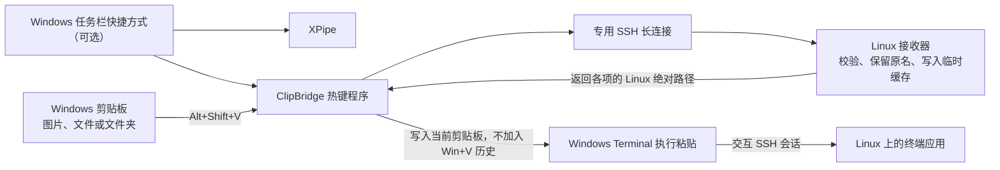

# clip-win-linux

<p align="center"><a href="README.md">English</a> | <strong>简体中文</strong></p>

ClipBridge 将 Windows 剪贴板里的图片、文件和文件夹传到 Linux。每个上传的图片、文件或文件夹都会返回 Linux 绝对路径。开启自动粘贴后，ClipBridge 会把这些路径贴到 Windows 上的 SSH 终端。

> **让 Agent 部署？** 让它先读 [AGENTS.md](AGENTS.md) 和 [部署依赖](DEPENDENCIES.md)，再按你的环境选择安装目录和 SSH 别名。

## 架构



上传和终端使用各自的 SSH 连接。XPipe 完全退出后，联动启动器会等正在进行的上传结束，再关闭 ClipBridge。Linux 接收器通过 SSH 标准输入输出工作，无需图形会话。当前在 Debian 上验证过。其他发行版需要 Python 3、Pillow 和 OpenSSH，自动清理脚本还需要 systemd 用户服务，或者由该系统的定时工具运行清理命令。

## 快速开始

先按 [部署依赖](DEPENDENCIES.md) 检查环境。默认 SSH 别名是 `linux`，也可以指定其他别名。请选择 Windows 安装目录，例如当前用户的 `%LOCALAPPDATA%\ClipBridge`。Windows 脚本和 EXE 放在同一目录。

1. Debian 安装 Python 3 和 Pillow 后，在仓库运行 `bash debian/install.sh`。该脚本安装接收器并启用每小时缓存清理计时器。
2. Debian sshd 必须允许 `CLIPBRIDGE_WS` 环境变量。检查并重载 sshd 的步骤见 [Agent 部署指南](AGENTS.md#debian-端)。保持现有 SSH 会话，直到新连接验证成功。
3. Windows OpenSSH 配置中的 `Host linux` 段设置 `SetEnv CLIPBRIDGE_WS=workspace-a`；设备 B 使用 `workspace-b`。验证：

   ```powershell
   ssh -nT -o BatchMode=yes -o StrictHostKeyChecking=yes linux '~/.local/bin/clipbridge doctor'
   ```

4. 在 Windows 构建环境运行 `windows/build-hotkey.ps1`。将生成的 `ClipBridgeHotkey.exe`、`clipbridge-agent.ps1` 和 `clipbridge-notify.ps1` 放在同一目录。
5. 在安装目录运行 `./ClipBridgeHotkey.exe --ssh-host linux`，再复制图片、文件或文件夹，按 `Alt+Shift+V`。新版进度卡片用 Windows 自带 Direct2D/DirectWrite 绘制，超过约 300 毫秒才显示，避免小任务闪窗。成功后，接收端保留文件名和目录结构，并返回各项的 Linux 绝对路径。

### 开启自动粘贴（可选）

在 EXE 所在目录运行以下命令。若已有实例正在运行，先执行 `.\ClipBridgeHotkey.exe --stop`，再用新参数启动。

```powershell
.\ClipBridgeHotkey.exe --ssh-host linux --auto-paste WindowsTerminal.exe
```

### 随 XPipe 启停（可选）

1. 先用 `install-user-startup.ps1 -SshHost linux -AutoPasteTerminal WindowsTerminal.exe` 设置 `ClipBridge Hotkey` 计划任务的启动参数。联动脚本从这个任务读取参数。
2. 把 `start-with-xpipe.ps1` 和 `start-with-xpipe.vbs` 放到 EXE 同目录。把原 XPipe 快捷方式复制到该目录，命名为 `XPipe-original.lnk`。
3. 新建 Windows 快捷方式。目标设为 `wscript.exe //B //Nologo "<实际 Windows 安装目录>\start-with-xpipe.vbs"`，按实际安装位置调整路径，并将快捷方式固定到任务栏。
4. 在 Windows PowerShell 中运行 `Stop-ScheduledTask -TaskName 'ClipBridge Hotkey'` 和 `Disable-ScheduledTask -TaskName 'ClipBridge Hotkey'`。保留此任务，供启动器读取参数。以后从新快捷方式启动 XPipe。

## 配置

| 项目 | 默认值 | 含义 |
|---|---|---|
| `--ssh-host alias` | `linux` | Windows 端专用长连接所用别名；使用该别名的现有密钥和主机信任配置。 |
| SSH `SetEnv CLIPBRIDGE_WS` | 必填 | `workspace-a` 或 `workspace-b`，隔离不同 Windows 设备的存储目录。 |
| `--auto-paste terminal.exe` | 关闭 | 允许向指定的前台终端执行自动粘贴，例如 `WindowsTerminal.exe`。 |
| `--paste-timeout seconds` | 8 秒 | 自动粘贴的等待上限，范围 1–60 秒。 |
| PNG 单文件上限 | 15 MiB | Windows 剪贴板位图编码成 PNG 后的大小上限。 |
| 普通文件上限 | 128 MiB | 单个文件大小。 |
| 单次上传上限 | 256 MiB | 一批文件的总大小；最多 200 个文件或目录项。 |
| 缓存 TTL | 24 小时 | Debian 接收文件默认保留期；近期文件及配额回收另受清理器保护。 |

## 用法

- `Alt+Shift+V`：读取 Windows 剪贴板并上传。自动粘贴时会把回执路径写入当前 Windows 剪贴板，并标记为不加入 `Win+V` 历史。同一 ClipBridge 进程复用专用 SSH 通道。可在图片或文件传输期间切换窗口，收到成功回执后，程序只在原前台窗口仍匹配、未超时且剪贴板未被更改时尝试粘贴。跳过时可在对应工作空间运行 `clipbridge latest` 取回路径。
- 自动粘贴通过 Windows 剪贴板和终端的 Ctrl+Shift+V 完成。远端 Codex CLI 已验证能把图片路径识别成附件。其他终端和 Agent 请按 [桌面验收表](tests/manual-test-matrix.md) 验证。普通文件和文件夹的输出仍是路径。
- 进度卡片不抢焦点，按原窗口所在屏幕右下角显示；百分比只用于已知总字节的上传阶段。高 DPI 清晰度需要在 Windows 100%、125%、150%、200% 缩放下实测。
- `windows/clipbridge-send.ps1`：一次性手动上传工具，用 `-SshHost` 指定同一个别名，兼容 PNG 与归档输入；成功后在标准输出返回 Linux 绝对路径。
- `clipbridge doctor`：检查工作空间和存储。
- `clipbridge latest`：查看该工作空间最近成功回执。
- `clipbridge stats --all`：查看缓存占用统计。
- `clipbridge prune --all [--dry-run]`：执行或预览缓存清理。
- `clipbridge serve --stdio`：供 Windows 持久 SSH 通道使用的帧式协议入口。

文件保存在 `~/.local/share/clipbridge/<workspace>/batches/`。清理器每小时运行，按 24 小时 TTL、磁盘配额和近期文件保护策略回收旧数据。缓存不能作为唯一备份。

接收端测试：`/usr/bin/python3 -B -m unittest discover -s tests -v`。Windows PowerShell 与真实终端的桌面验收步骤见 [桌面验收表](tests/manual-test-matrix.md)。
